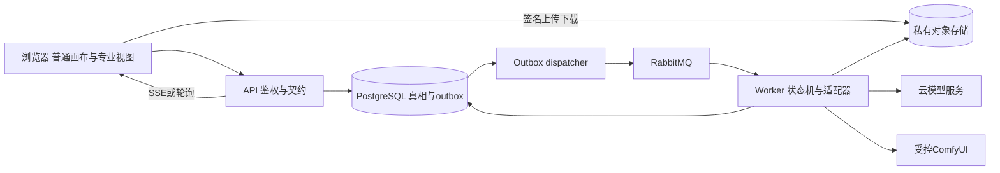

# 系统架构

状态：模块化单体API加独立worker为实施建议；框架须经旧代码审计与兼容原型决定。

## 模块职责

API处理身份、项目归属、修订、版本、运行提交、授权与下载；worker处理资料解析、缩略图、模型调用及归档。两者同仓共享JSON Schema契约但分别部署，图像计算不占用API事件循环。PostgreSQL是任务和引用真相；MQ仅传递消息，对象存储保存文件字节。普通画布库与节点UI库均不承担执行引擎职责。

前端不直连DB、MQ、GPU，也不持有供应商密钥。运营方控制ComfyUI端点；不向公网暴露8188或插件管理器。

## 数据一致性

每项目一个普通画布，普通对象与工作流节点ID空间独立；展示连线不是执行边。版本、输入引用、运行快照不可变。运行提交在一个DB事务中写run、快照、预算冻结及outbox；dispatcher在提交后投递。消息至少一次，worker按run/step防重；外部收费副作用没有天然恰好一次保证。

画布保存和任务执行分别处理请求和事务。结果回填按输出唯一键，在事务锁内追加对象与修订；不取得用户编辑租约。客户端遇到修订变化重取并合并未提交操作，不覆盖系统追加内容。

## 故障边界

GPU不可用仅降级生成能力，不阻止打开项目。供应商已接单但响应丢失进入unknown，通过request ID核查；归档失败只重试存储。SSE使用持久事件游标，断开转轮询。取消是尽力请求，不等同已停止或免收费。

## 部署与扩展

首期候选是单Linux实例承载API、DB、MQ、worker，加独立GPU和私有桶；不构成高可用。之后按CPU、LLM、GPU队列扩容并分离数据库，暂不强依赖Kubernetes、Temporal、Dify或LangGraph。容量及成本依据真实调用与基准，不能凭组件宣传值推断。
