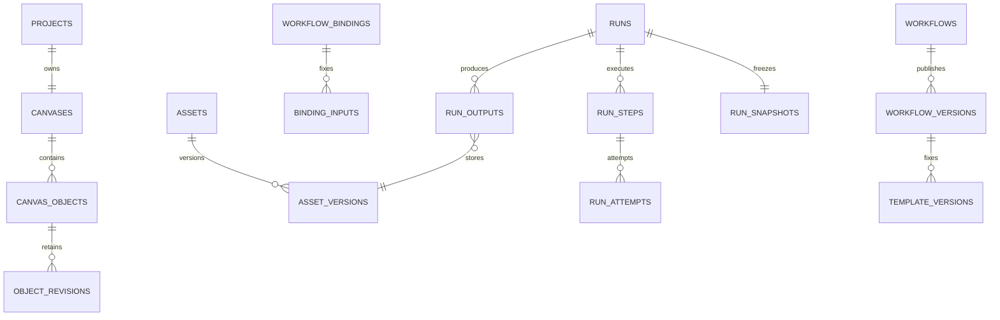

# 数据库规格

状态：根据源方案正文补充的逻辑Schema建议，未收到原字段字典或参考DDL；不是可直接执行的生产迁移。候选数据库PostgreSQL，所有时间timestamptz UTC，标识UUID，版本号bigint，hash为sha256十六进制，费用numeric(20,8)并携带币种。

## 通用约束

项目资源均含project_id；可跨组织查询的项目含organization_id。父表建立UNIQUE(project_id,id)，子表用(project_id,parent_id)复合外键，禁止只按裸UUID连接不同项目。必填归属、状态、创建时间非空；JSONB字段使用版本化JSON Schema和服务端校验，不能替代外键。软删字段deleted_at可空。

## 核心表

下列字段除显式标为可空外均必填；id是主键，关系字段为外键。通用created_at默认服务端时间。实际迁移需补全check、索引、级联策略及RLS后经T01验证。

| 表 | 关键字段 | 约束与关系 |
| --- | --- | --- |
| users | id, issuer, subject, created_at | UNIQUE(issuer,subject)，不保存OIDC原始令牌 |
| organizations | id, name, owner_user_id, created_at | owner指users |
| organization_members | organization_id, user_id, role | 复合主键；角色不得由客户端自赋 |
| projects | id, organization_id, name, created_by, created_at, deleted_at可空 | UNIQUE(organization_id,id) |
| project_members | project_id, user_id, role | 复合主键；owner/creator/designer/viewer |
| canvases | id, project_id, revision, viewport, created_at | UNIQUE(project_id)，revision≥0 |
| canvas_objects | id, project_id, canvas_id, type, current_revision, deleted_at可空 | 当前对象身份与修订指向；位置在修订内 |
| object_revisions | project_id, object_id, revision, payload, content_hash, created_at | PK(project_id,object_id,revision)，不可修改；payload含几何和类型数据 |
| canvas_edges | id, project_id, source_object_id, target_object_id, label可空 | 两端复合FK；仅展示关系 |
| edit_leases | project_id, canvas_id, holder_user_id, token_hash, fencing_token, expires_at | 每画布一租约，原子接管递增fencing |
| assets | id, project_id, kind, created_by, deleted_at可空 | 逻辑资产，不保存文件字节 |
| asset_versions | id, project_id, asset_id, version, storage_key, sha256, byte_size, mime, metadata, status, created_at | UNIQUE(project_id,asset_id,version)，storage_key唯一，ready后内容不可变 |
| upload_sessions | id, project_id, asset_id, expected_size, expires_at, state | 完成核验后关联版本；预期hash可空且非可信依据 |
| workflows | id, project_id, name, default_version_id可空 | 默认指向所属workflow版本 |
| workflow_versions | id, project_id, workflow_id, version, graph, dependency_manifest, content_hash, created_at | UNIQUE(project_id,workflow_id,version)，发布payload不可UPDATE |
| templates | id, project_id, name, default_version_id可空 | 逻辑模板 |
| template_versions | id, project_id, template_id, workflow_version_id, version, parameter_schema, form_schema, mapping, output_schema, content_hash | 固定图版本，UNIQUE(project_id,template_id,version) |
| workflow_bindings | id, project_id, task_line_id, workflow_version_id, template_version_id可空, input_mapping, output_mapping, created_at | 绑定不可变，显式更新派生新行 |
| binding_inputs | id, project_id, binding_id, object_id, object_revision, asset_version_id可空, node_id, port | 复合FK指固定对象修订和资产；node校验对应版本graph |
| runs | id, project_id, binding_id可空, state, snapshot_id, replay_of可空, created_by, created_at, updated_at | state经后端状态机转换 |
| run_snapshots | id, project_id, payload, content_hash, schema_version, created_at | 不可变，见WORKFLOW_SPEC |
| run_steps | id, project_id, run_id, node_id, state, started_at可空, finished_at可空 | UNIQUE(run_id,node_id)；首版DAG无循环 |
| run_attempts | id, project_id, step_id, attempt_no, client_request_id, provider_request_id可空, submission_certainty, state, error可空 | UNIQUE(step_id,attempt_no)，provider ID按provider作用域去重 |
| run_outputs | id, project_id, run_id, output_key, asset_version_id, canvas_object_id可空 | UNIQUE(run_id,output_key) |
| run_events | id, project_id, run_id, sequence, type, payload, created_at | UNIQUE(run_id,sequence)，SSE按序读取 |
| agent_sessions | id, project_id, user_id, level, scope, limits, state, created_at | 等级和授权由权限内核校验 |
| action_proposals | id, project_id, session_id, tool_version, arguments, arguments_hash, input_revisions, max_cost, currency, policy_version, state | 不存密钥，变更派生新proposal |
| approvals | id, project_id, action_id, approved_by, nonce_hash, expires_at, consumed_at可空 | action关联不可变参数，nonce唯一且原子消费 |
| budgets | id, project_id, currency, period_start, period_end, limit_amount, reserved_amount, spent_amount | 金额非负，行锁保护并发冻结 |
| budget_reservations | id, project_id, budget_id, run_id, amount, state | UNIQUE(budget_id,run_id)，冻结/释放/结算幂等 |
| usage_events | id, project_id, run_id, provider, external_event_key, usage, actual_cost可空, currency, price_version, certainty | UNIQUE(provider,external_event_key)，未知费用不记零 |
| outbox | id, project_id, aggregate_id, event_type, payload, created_at, dispatched_at可空 | 与run同事务写入，投递失败可恢复 |
| idempotency_records | actor_id, project_id, operation, key, request_hash, response, expires_at | 四项作用域加key唯一，同键异参拒绝 |
| audit_events | id, project_id, actor_id可空, action, resource_ref, summary, created_at | 追加写，脱敏；系统actor可空 |

## ER关系

## 事务、索引与安全

画布写锁定canvas，验证租约和base_revision后追加对象修订并递增revision；结果回填在同一锁域追加，不能覆盖编辑。run创建、预算冻结、快照和outbox原子提交。资产ready与run_outputs登记是成功前置；桶与DB不具有跨系统事务，以隔离状态、重试和孤儿清理恢复。

建议索引：(project_id,deleted_at)、(project_id,state,created_at)、(run_id,sequence)、binding_inputs(project_id,object_id,object_revision)、asset_versions(project_id,sha256)、outbox(created_at) WHERE dispatched_at IS NULL。索引效果以执行计划和基准确认。

API验证session和成员权限；RLS作为第二道边界。运行角色无BYPASSRLS，服务端事务内设置可信SET LOCAL上下文，连接池归还前事务结束。项目删除仅owner；creator/designer可编辑但不可删项目；viewer只读。后台任务使用明确项目上下文，不因worker身份获得任意租户通配权限。

历史表禁止业务UPDATE/DELETE；隐私清理走独立受审计特权流程。迁移必须包含升级、兼容旧应用和备份恢复验证；未形成完整DDL、RLS负例及迁移证据前不得投产。
